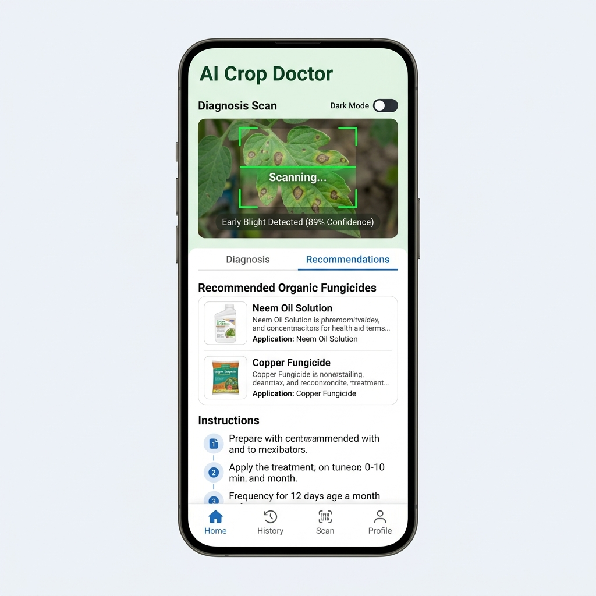
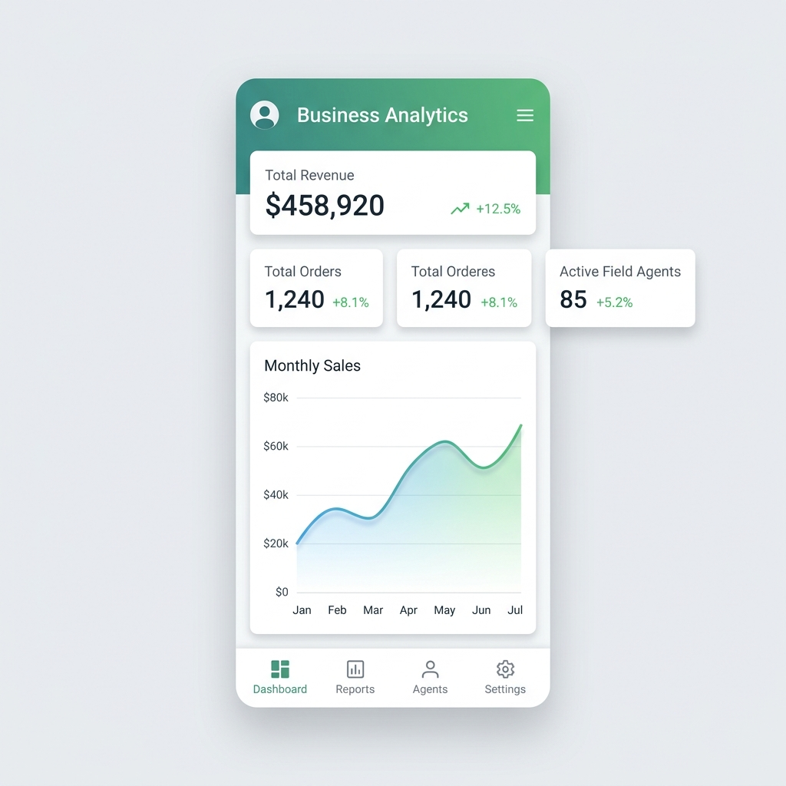

# 🌾 Kisan Suvidha (किसान सुविधा)

### *An Enterprise-Grade, Multilingual Agri-Commerce & Logistics Mobile Ecosystem*


---

## 📖 Overview

**Kisan Suvidha** (translated: *Farmer Facility*) is a high-performance, resilient mobile application built on **React Native (Expo SDK 54)** and **TypeScript**, backed by **Firebase Services**. Designed specifically for the Indian agricultural landscape, it connects three key roles—**Farmers**, **Suvidhaks (Field Facilitators)**, and **Administrators**—into a single synchronized ecosystem. 

The application facilitates agricultural retail, local weather alerts, crop logs, field agent logistics tracking, and administrative business intelligence.

---

## 📱 Core Modules & User Interfaces

### 1. The Farmer Agri-Input Shop
The Farmer interface features a clean, high-performance shopping page utilizing warm paper-tints and organic earth tones. It organizes agri-inputs (seeds, fertilizers, pesticides, tools) into structured, scrollable catalog grids.

* **Agri-Input Catalog**: Browse seeds, fertilizers, pesticides, and tools in a responsive two-column grid showing product cards with pricing and rating data.
* **Category Filtering**: Horizontal, interactive chips to quickly toggle catalog focus (e.g., Seeds, Fertilizers, Pesticides).
* **Cart Badge Integration**: Active cart count updates in real-time on the global header badge for continuous feedback.

<p align="center">
  
</p>

---

### 2. AI Krishi Doctor (Future Roadmap Feature)
The AI Krishi Doctor module is planned to allow instant leaf scan diagnostics, highlighting pest damage and leaf blight using computer vision, and mapping matches to inventory products.

* **Image Scanning**: Integration with `expo-image-picker` to capture or upload crop leaf photographs.
* **Diagnostics Pipeline**: Runs image categorization and identifies leaf disease confidence.
* **Automated Prescription**: Prompts the matching pesticides or organic fertilizers from the active Firestore catalog, allowing farmers to add them to the cart instantly.

<p align="center">
  
</p>

---

### 3. Suvidhak (Field Agent) Hub
Field Agents (*Suvidhaks*) serve as local intermediaries who help onboard farmers, record cash/credit purchases on-site, and manage local delivery dispatches.

* **Assisted Sales Engine**: Log point-of-sale transactions and customer data on behalf of offline farmers.
* **Offline Delivery Dispatch**: Tracks delivery runs and updates payment verification status.
* **Gamified Leaderboard**: A performance leaderboard that aggregates transaction totals per agent, sorting them in O(N log N) complexity to rank active facilitators.

---

### 4. Admin Operations & Business Intelligence
Administrators manage inventory catalogs, resolve support tickets, and analyze performance across regions.

* **Inventory Management**: Control catalog parameters (add, modify, delete input products and variants).
* **BI Dashboard**: Renders interactive sales trend analytics, average order value (AOV), and facilitator metrics using **React Native Chart Kit** custom bezier lines.

<p align="center">
  
</p>

---

## 🏗️ Technical Architecture & Design Implementation

The codebase is structured around **Clean Architecture** principles to separate business logic, dynamic styling, components, and data mapping.

```
KisanSuvidha/
├── app/                        # File-Based Expo Router Stack & Guards
│   ├── _layout.jsx             # Root layout wrapping global ErrorBoundary
│   ├── index.jsx               # Bootloader & Role-based Navigation Guard
│   ├── login.jsx               # Phone authentication screen
│   ├── farmer-*.jsx            # Farmer layout modules
│   ├── suvidhak-*.jsx          # Suvidhak (Field Facilitator) dashboard screens
│   └── admin-*.jsx             # Administrative console modules
├── components/                 # Reusable Presentation Layer
│   ├── BeautifulButtons.jsx    # Animated primary and secondary haptic buttons
│   ├── BeautifulCards.jsx      # Specialized stat, product, and alert cards
│   ├── SkeletonLoader.jsx      # Shimmer loaders running on native animation drivers
│   └── ErrorBoundary.jsx       # Global JavaScript runtime exception handler
├── utils/                      # Business Logic & Utility Functions
│   ├── database.js             # Decoupled Firestore collection queries
│   ├── theme.js                # Dynamic ThemeProvider (Earth, Sage, Ocean, etc.)
│   └── ui.js                   # Async pipelines (safeAsync, withRetry, debounce)
└── config/                     # Native SDK Initializers
    └── firebase.js             # Firebase Auth, Firestore, and Storage setup
```

### ⚡ Technical Optimizations

1. **Native Thread-Driven Loading Animation**:
   [SkeletonLoader.jsx](components/SkeletonLoader.jsx) uses React Native `Animated` API with `useNativeDriver: true` to loop shimmer loops, shifting interpolation computations from the JavaScript event loop to the Native OS thread for a stable 60 FPS transition state.
2. **Resilient Network Request Wrapper**:
   [ui.js](utils/ui.js) houses `safeAsync` and `withRetry` functions. The retry hook implements a linear backoff algorithm (`delayMs * attempt`) to recover failed remote executions during offline states.
3. **Firestore Connection Protection**:
   All dynamic queries in [database.js](utils/database.js) are managed through listener hooks that execute cleanups (`onSnapshot` unsubscribes) on component teardown, preventing active socket leaks and minimizing network overhead.
4. **Exception Containment**:
   [ErrorBoundary.jsx](components/ErrorBoundary.jsx) acts as a declarative boundary capturing rendering exceptions, parsing trace messages in development mode, and displaying a recovery fallback state to prevent white-screen application crashes.
5. **Dynamic Branding Tokens**:
   [theme.js](utils/theme.js) exposes a central Context provider mapping spacing scales, dynamic color configurations (such as Warm Earth, Sage Green, Deep Midnight), and haptic feedbacks to guarantee UX uniformity.

---

## 🛠️ Setup & Operations Documentation

To setup, install, run, or review the system design, please refer to the specific guides housed in the [docs/](docs) directory:

* **⚙️ Local Development Setup**: Refer to [docs/INSTALLATION.md](docs/INSTALLATION.md) for installation commands, prerequisites, and Firebase settings.
* **🏗️ App Architecture**: Review [docs/ARCHITECTURE.md](docs/ARCHITECTURE.md) to understand data flows, screen states, and styling.
* **🤖 ML Feature Blueprint**: Learn about the AI Krishi Doctor and Fertilizer recommendation setup in [docs/ML_FEATURES_PLAN.md](docs/ML_FEATURES_PLAN.md).
* **🩹 Bug & Security Report**: Review fixes made and active security benchmarks in [docs/BUG_REPORT.md](docs/BUG_REPORT.md).
* **🚀 Quality Checklist**: Reference [docs/PROFESSIONAL_CHECKLIST.md](docs/PROFESSIONAL_CHECKLIST.md) for verification criteria.
