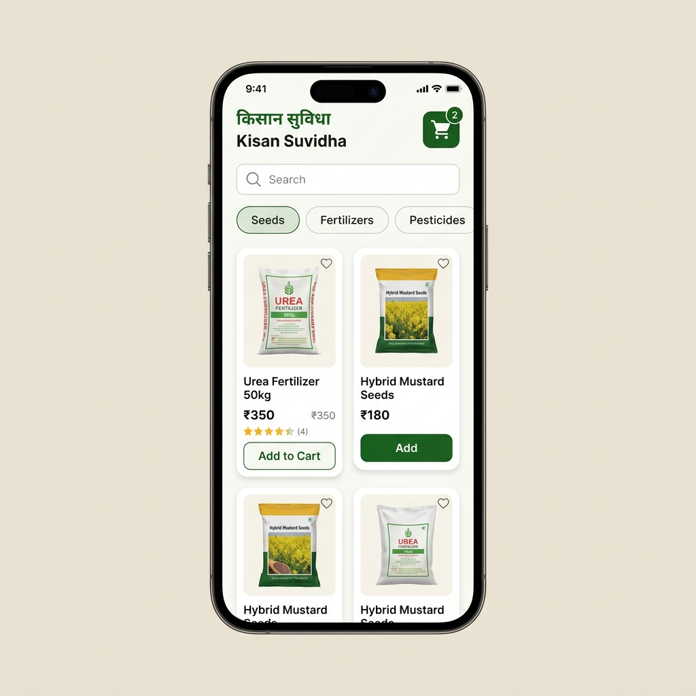

# 🌾 Kisan Suvidha (किसान सुविधा)

### *Your Digital Agricultural Companion*

---

## 📖 About the App

**Kisan Suvidha** (translated: *Farmer Facility*) is a modern mobile application designed to support the Indian farming community. Built using React Native and Firebase, the app brings together **Farmers**, **Field Agents (Suvidhaks)**, and **Administrators** into a single, easy-to-use platform for agricultural commerce and support.

---

## 📱 Key Features

### 1. Farmer Shop & Crop Guides
* **Agricultural Shop**: Browse and buy seeds, fertilizers, pesticides, and tools in a clean, user-friendly shop catalog.
* **Crop insights**: Access schedules, crop logs, and custom weather advice.

  

---

### 2. AI Krishi Doctor (AI Crop Doctor)
* **Leaf Scan Diagnosis**: Snap a photo of a diseased crop leaf to get an instant diagnosis.
* **Product Matches**: Get recommendations for the exact organic treatments or pesticides available in the shop.

  

---

### 3. Field Agent (Suvidhak) Dashboard
* **Assisted Sales**: Log purchases and customer details directly for offline farmers.
* **Logistics Tracker**: Manage active deliveries and collect payments.
* **Leaderboard**: Track agent sales performance rankings on a friendly leaderboard.

---

### 4. Admin Management
* **Catalog Control**: Easily add, edit, or delete products and price details.
* **Sales Analytics**: View total revenue, active orders, and sales trends on interactive charts.

  

---

## 📂 Project Organization

* **`app/`**: Application navigation pages and user screens.
* **`components/`**: Reusable UI elements (custom buttons, cards, skeletons, and loaders).
* **`docs/`**: Setup, installation, architecture, and feature manuals.
* **`utils/`**: Helper files (database calls, theme configurations, error checks).
* **`assets/`**: Images, icons, and crop resources.

---

## 🚀 Setup & Documentation Guides

For help setting up the project locally or reviewing its design details, refer to the files in the **[docs/](docs)** directory:

* **⚙️ How to Install and Run**: See [docs/INSTALLATION.md](docs/INSTALLATION.md) for step-by-step setup and Firebase configurations.
* **🏗️ App Architecture**: Read [docs/ARCHITECTURE.md](docs/ARCHITECTURE.md) to understand navigation logic and data structures.
* **🤖 AI/ML Features Guide**: Review the smart recommendations blueprint in [docs/ML_FEATURES_PLAN.md](docs/ML_FEATURES_PLAN.md).
* **🩹 Bug Fixes & Checks**: Read [docs/BUG_REPORT.md](docs/BUG_REPORT.md) and [docs/PROFESSIONAL_CHECKLIST.md](docs/PROFESSIONAL_CHECKLIST.md) for quality logs.
